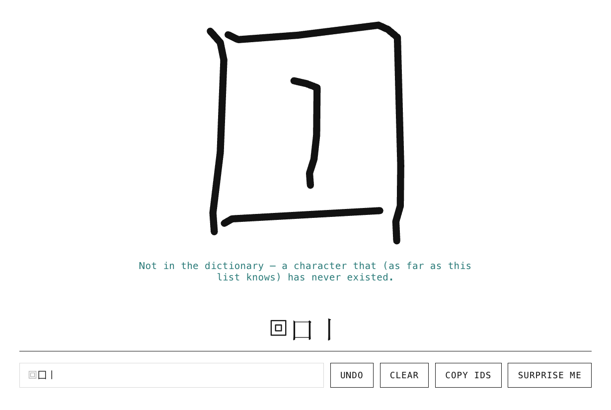
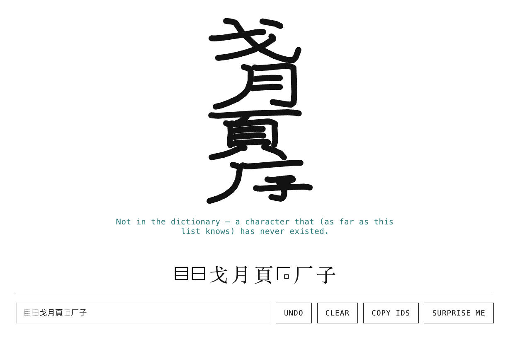
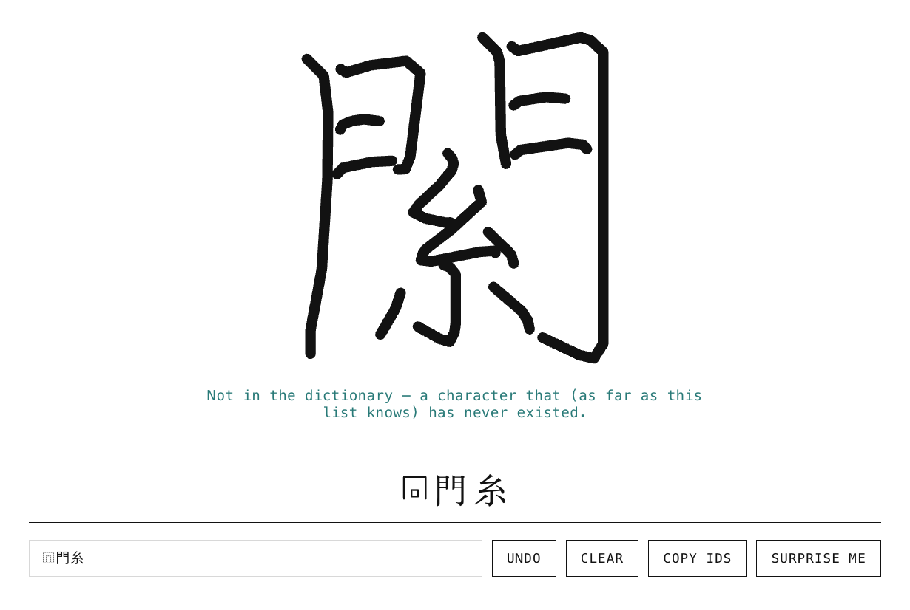
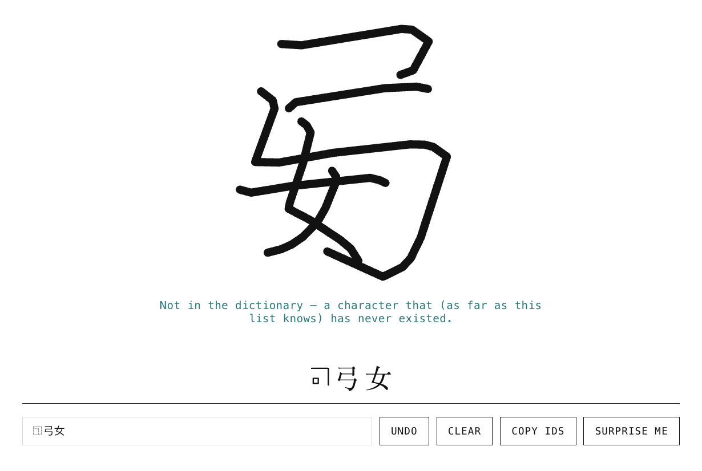
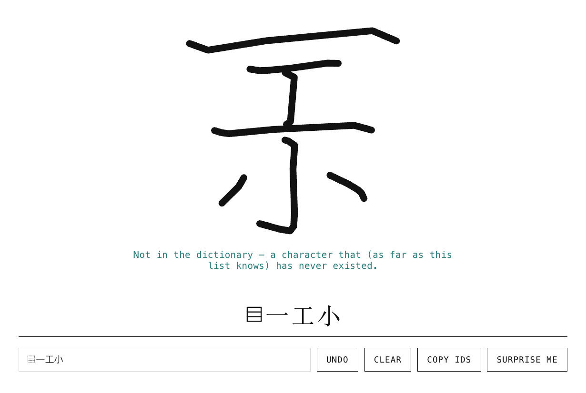

# 🀄 Hanzi Forge

Take real Chinese characters apart into their IDS trees, then build characters that have never existed from valid, rule-checked parts.

**Try it live: https://programminginpoppyfields.github.io/hanzi-forge/**

Everything runs in the browser. There is no backend; the data is a few static JSON files.

The two tabs are mirror images of each other. **Decompose** goes from a character down to its parts (the tree grows downward); **Compose** goes from parts up to a character (the same tree, upside down). Both share the same input, controls, big-character square and label stack, and each can hand its character to the other.

## Decompose

Type a single Han character and see its recursive **IDS** (Ideographic Description Sequence) breakdown as a tree. Each level of decomposition gets its own color, and hovering a node traces its branch (click to pin it). **Surprise me** picks a random character, and **Open in Compose ↑** sends the character's decomposition over to the other side.

<p align="center"></p>

## Compose

Go the other way. Type or paste an IDS string, or open the **Keyboard** to pick operators (⿰ ⿱ ⿸ …) and parts (八, 亅, 門 …). The parts sit on top and converge down through the operator into the new character, with a note on whether the dictionary already has it. Operators are drawn as little icons in the input, since most fonts can't display them.

<p align="center"></p>

### More invented characters

None of these exist in the dictionary. In order: ⿴囗丨, ⿳⿱戈月頁⿸厂子, ⿵門糸, ⿹弓女 and ⿳一工小.

<table>
  <tr>
    <td></td>
    <td></td>
    <td></td>
  </tr>
  <tr>
    <td></td>
    <td></td>
    <td></td>
  </tr>
</table>

- **Invalid combinations are blocked.** Nothing is hand-written: the rules are learned from the ~9,500 real characters in the dictionary. A part can only fill a slot (left, top, inside an enclosure, …) if real characters use it that way, and a part must have wrapped or overlaid in at least 3 real characters before it can do so here. That is why 雨 can sit on top of something but can't enclose it.
- **New characters are typeset, not stretched.** Each part is drawn from real Noto Sans SC outlines, reshaped so vertical and horizontal stems share one thickness. Enclosed parts are placed in the outer part's real empty space, and anything that would collide is shrunk until it clears, so squeezed parts read as one character.
- **Surprise me** rolls a random valid new character.

"Never existed" only means *not in this dictionary*. Unicode has far more characters than the ~9,500 here, so a real rare character can still be reported as new.

## Run it

```bash
npm install
npm run dev
```

Then open the URL it prints (usually `http://localhost:5173`). `#compose` in the URL jumps straight to the Compose tab.

The generated data files are committed in `public/`, so nothing else is needed. To regenerate the dictionary and stroke data (downloads about 33 MB):

```bash
npm run build:data
```

The typeface outlines (`public/outlines.json`, loaded only by the Compose tab) come from a Python script. It needs `pip install fonttools shapely numpy` and downloads Noto Sans SC Regular (about 8 MB):

```bash
python3 scripts/build-outlines.py
```

## How it's put together

| Layer | File |
| --- | --- |
| Operator definitions | `src/data/ids-data.js` |
| Dictionary / stroke loading | `src/data/dictionary.js`, `src/data/strokes.js` |
| IDS parsing and recursive tree building | `src/lib/tree-builder.js` |
| Tree layout (hand-rolled tidy-tree) | `src/lib/tree-layout.js` |
| Compose rules, learned from data | `src/lib/ids-rules.js` |
| Compose slot layout | `src/lib/ids-compose.js` |
| Typeset invented characters (canvas) | `src/lib/glyph-fit.js` |
| Stroke-drawn fallback (while outlines load) | `src/lib/stroke-glyph.js` |
| Rendering | `src/components/`, `src/pages/` |

Only React is used: no D3, no graph or UI libraries. Vite is the dev server and bundler.

To use a different dataset, make `scripts/build-dictionary.mjs` produce the same JSON shape: `{ ids: { 字: "⿰…" }, info: { 字: { pinyin, meaning } } }`.

## Data

Decompositions, pinyin, meanings and stroke skeletons come from [Make Me a Hanzi](https://github.com/skishore/makemeahanzi). Check that project's licenses before redistributing the generated files. Glyph outlines are from [Noto Sans SC](https://github.com/notofonts/noto-cjk) (SIL Open Font License), and the page loads the same typeface from Google Fonts.
