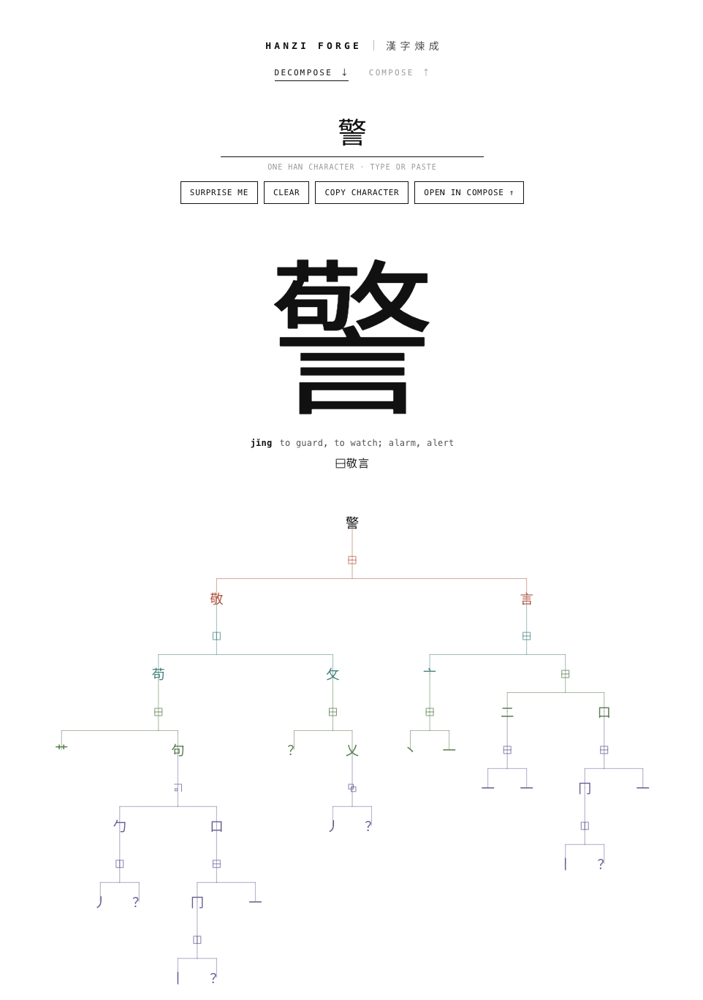

# 🀄 Hanzi Forge

Take real Chinese characters apart into their IDS trees, then build characters that have never existed from valid, rule-checked parts.

**Try it live: https://programminginpoppyfields.github.io/hanzi-forge/**

Everything runs in the browser. There is no backend; the data is two static JSON files.

## Decompose

Type a single Han character and see its recursive **IDS** (Ideographic Description Sequence) breakdown as a tree. Each level of decomposition gets its own color, and hovering a node traces its branch (click to pin it).



## Compose

Go the other way. Pick operators (⿰ ⿱ ⿸ …) and parts (八, 亅, 門 …), or paste an IDS string, and the character is drawn for you, with a note on whether the dictionary already has it.


- **Invalid combinations are blocked.** Nothing is hand-written: the rules are learned from the ~9,500 real characters in the dictionary. A part can only fill a slot (left, top, inside an enclosure, …) if real characters use it that way, and a part must have wrapped or overlaid in at least 3 real characters before it can do so here. That is why 雨 can sit on top of something but can't enclose it.
- **New characters are drawn from stroke skeletons**, re-stroked at one line weight, so squeezed parts read as one character instead of pasted-together glyphs.
- **Surprise me** rolls a random valid new character.

"Never existed" only means *not in this dictionary*. Unicode has far more characters than the ~9,500 here, so a real rare character can still be reported as new.

## Run it

```bash
npm install
npm run dev
```

Then open the URL it prints (usually `http://localhost:5173`). `#compose` in the URL jumps straight to the Compose tab.

The generated data files are committed in `public/`, so nothing else is needed. To regenerate them (downloads about 33 MB):

```bash
npm run build:data
```

## How it's put together

| Layer | File |
| --- | --- |
| Operator definitions | `src/data/ids-data.js` |
| Dictionary / stroke loading | `src/data/dictionary.js`, `src/data/strokes.js` |
| IDS parsing and recursive tree building | `src/lib/tree-builder.js` |
| Tree layout (hand-rolled tidy-tree) | `src/lib/tree-layout.js` |
| Compose rules, learned from data | `src/lib/ids-rules.js` |
| Compose layout and stroke fitting | `src/lib/ids-compose.js`, `src/lib/stroke-glyph.js` |
| Rendering | `src/components/`, `src/pages/` |

Only React is used: no D3, no graph or UI libraries. Vite is the dev server and bundler.

To use a different dataset, make `scripts/build-dictionary.mjs` produce the same JSON shape: `{ ids: { 字: "⿰…" }, info: { 字: { pinyin, meaning } } }`.

## Data

Decompositions, pinyin, meanings and stroke skeletons come from [Make Me a Hanzi](https://github.com/skishore/makemeahanzi). Check that project's licenses before redistributing the generated files.
